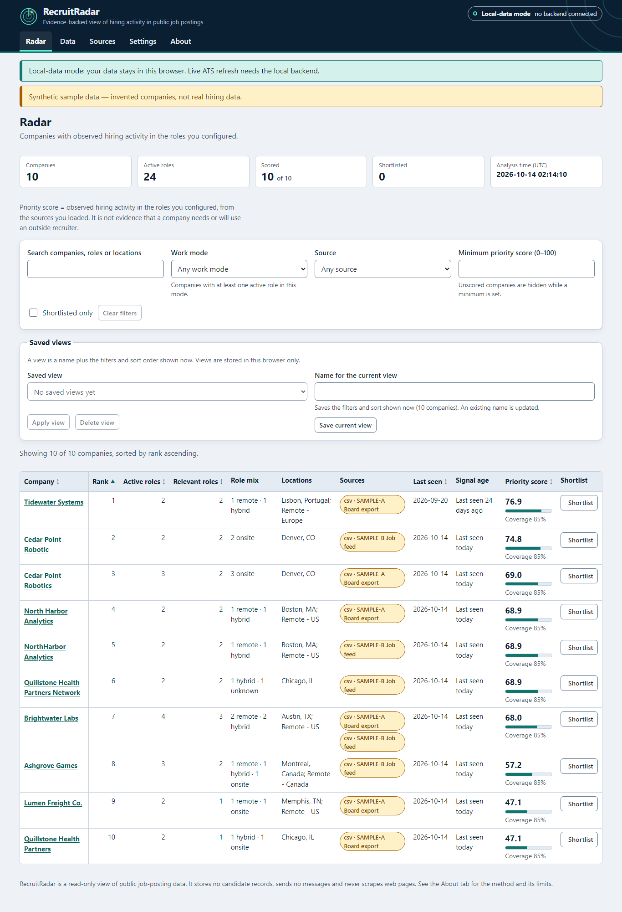

# RecruitRadar

Hiring-market intelligence from public job postings: normalized postings, company identity resolution, role de-duplication and an explainable priority score, in the browser with an optional local FastAPI backend.



> **Status:** local build, not deployed. There is no hosted demo; run it locally (below).
> The static demo (local-data mode) runs entirely in the browser on data **you** load. All sample
> data is synthetic and labeled as such. Scores describe _observed hiring activity_ only. They are
> not evidence that a company needs, or will use, an outside recruiter.

## What it does

- **Radar:** companies with active/relevant role counts, role mix, locations, sources, last seen,
  signal age and an explainable **priority score** with its coverage. Filters (text, work mode,
  source, minimum score, shortlisted only), sorting, and saved views.
- **Company detail:** roles with status and source links, role history events, per-component score
  breakdown (value, weight, plain-language calculation) and a **Missing information** list: parts
  that could not be measured are left out of the score, never counted as zero.
- **Data:** manual entry; CSV import with a line-by-line error report you can correct in place;
  datasets list; **merge review** for look-alike company names (never merged automatically);
  exports (shortlist CSV with evidence, all postings CSV).
- **Sources (connected mode):** add a Greenhouse, Lever or Ashby board, refresh it, and read the
  refresh history (status, error kind, seen/added/changed/removed/listed-again counts, host) and the
  role changes of the last run. Failed refreshes are recorded and never delete data.
- **Local-data mode (works offline, GitHub Pages friendly):** everything above except live refresh,
  stored in `localStorage` with corruption recovery and newer-schema protection.

## How it is verified

The scoring/identity logic is a pure function, `analyze()`, implemented **twice, independently**
(Python in `backend/recruit_radar/engine`, TypeScript in `src/engine`) from one written spec
(`docs/spec/`), plus a third stdlib-only oracle used to generate golden vectors. Both engines must
produce identical output on 47 analysis vectors and 173 normalization cases, and a seeded
cross-implementation fuzzer compares all three on ~950 generated inputs. The first fuzz run found
212 mismatches the hand-written vectors had missed; they were resolved from the spec text and are
recorded in [`docs/spec/ambiguities/differential.md`](docs/spec/ambiguities/differential.md).

## Quick start

Frontend only (local-data mode). Requires Node.js 20.19+:

```bash
npm ci
npm run dev        # http://localhost:5173/recruit-radar/
```

With the backend (connected mode, live read-only ATS refresh). Requires Python 3.11+:

```bash
python -m venv .venv
.venv/Scripts/python -m pip install -r backend/requirements.lock.txt   # Windows
# source .venv/bin/activate && pip install -r backend/requirements.lock.txt   # macOS/Linux
cd backend && ../.venv/Scripts/python -m recruit_radar                 # http://127.0.0.1:8787
```

Open the app; in Settings, choose **Automatic** (uses the backend when it answers) or **Use the
backend**.

## Commands

| Command                                                         | What it runs                                                           |
| --------------------------------------------------------------- | ---------------------------------------------------------------------- |
| `npm test`                                                      | Vitest: engine, CSV, data layer, view model, vectors                   |
| `npm run backend:test`                                          | pytest: engine, adapters, API, migrations, persistence, OpenAPI drift  |
| `npm run vectors:check`                                         | oracle self-check (vectors re-derived and hand-check values asserted)  |
| `npm run fuzz`                                                  | three-way cross-implementation fuzz (oracle / Python / TypeScript)     |
| `npm run e2e`                                                   | Playwright against the production build, a real backend and a fake ATS |
| `npm run lint` / `typecheck` / `backend:lint` / `backend:types` | ESLint, `tsc --noEmit`, ruff, mypy --strict                            |
| `npm run verify`                                                | everything above in order (also `scripts/verify.ps1` / `verify.sh`)    |

Local e2e uses the installed Microsoft Edge; CI installs Chromium (`CI` environment variable).

## Ethics and scope

No candidate records, no candidate scoring, no outreach, no guessed e-mail addresses, no logins, no
CAPTCHA evasion and no HTML scraping. Only three documented public read-only JSON APIs and data you
provide. A job opening is not proof that a company is willing to hire an outside recruiter.

## Docs

[Architecture](docs/architecture.md) · [Demo walkthrough](docs/demo.md) ·
[Known limitations](docs/known-limitations.md) · [Test report](docs/test-report.md) ·
[Spec](docs/spec/00-overview.md) · [Backlog](docs/backlog.md) · [Handoff](docs/handoff.md)

## License

MIT, see [LICENSE](LICENSE). AI-assistance disclosure: [AI_ASSISTANCE.md](AI_ASSISTANCE.md).
